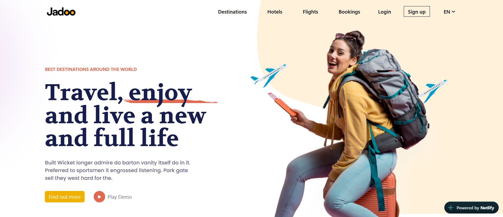
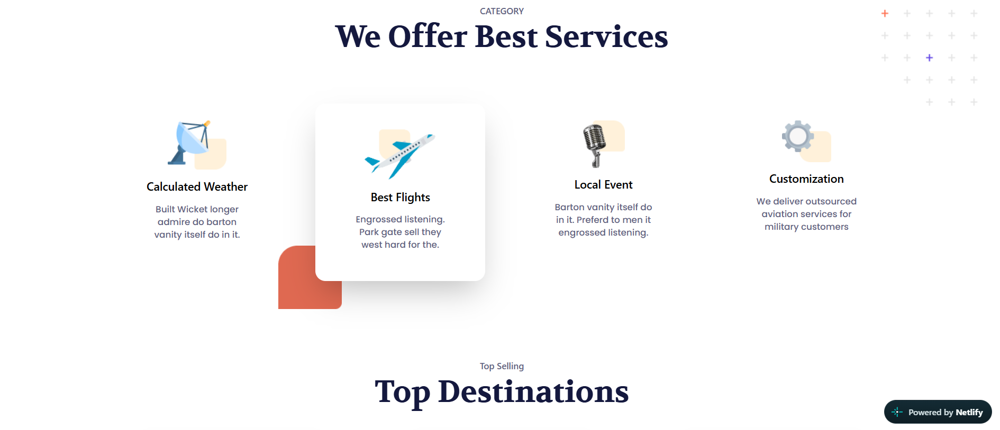
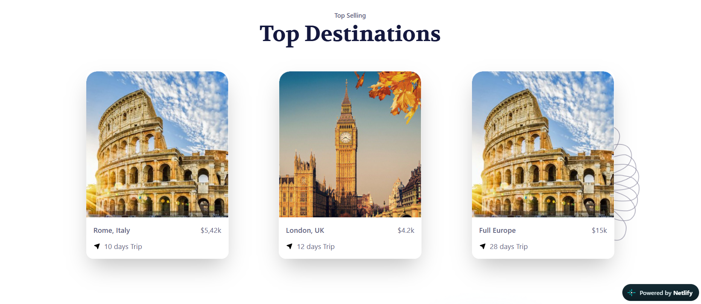
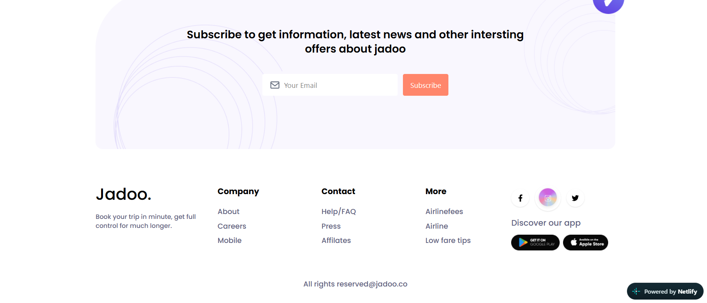

# ✈️ Travel Website

A beautiful and responsive travel website built using React.

## 🌐 Live Demo

🔗 https://travel999.netlify.app/

## 📸 Screenshots


## 📸 Screenshots









## ✨ Features

- Explore beautiful destinations
- Modern and attractive UI
- Responsive design
- Easy navigation

## 🛠️ Technologies Used

- React.js
- JavaScript
- Tailwind CSS
- Vite

## 🚀 Run Locally

```bash
git clone https://github.com/ravi1361/travel.git
cd travel-project
npm install
npm run dev
```

## 👨‍💻 Author

Ravi Hiremath